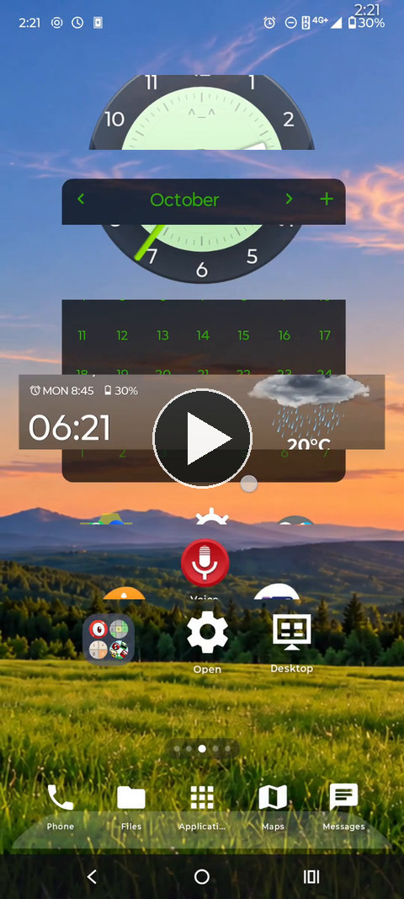
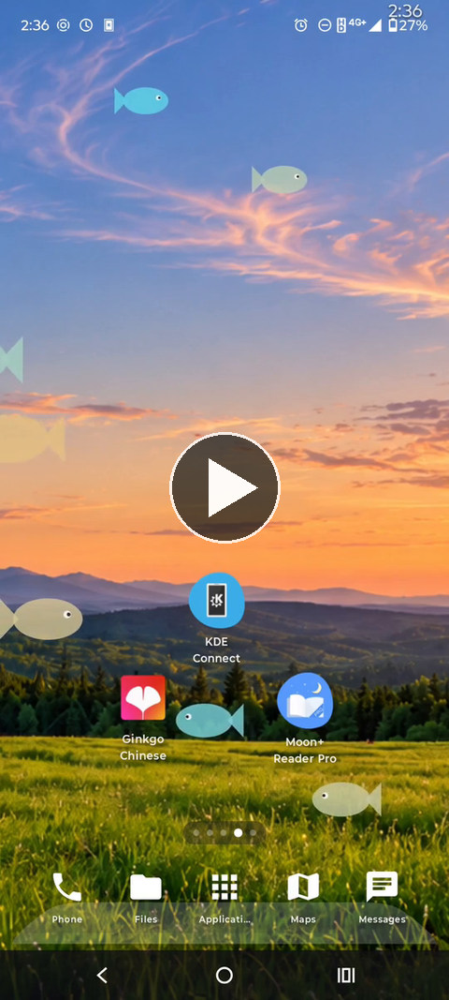
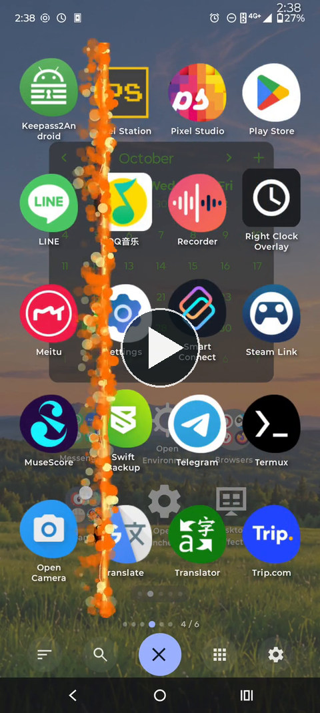
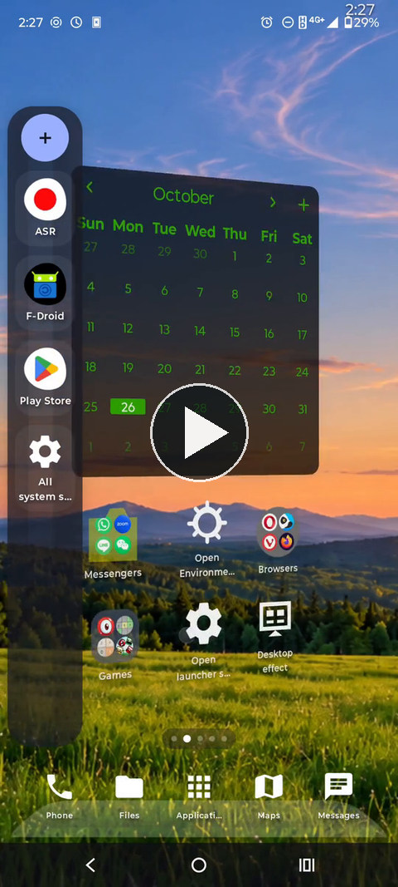

# e_e launcher

**An Android launcher built around familiar habits, personal needs, and the freedom to experiment.**

## Why I created e_e launcher

e_e launcher started out of necessity.

When I switched to a new phone, I wasn't willing to give up the features and familiar ways of working that I had grown accustomed to. Instead of simply accepting those limitations, I decided to create a launcher that would let me keep the experience I wanted.

What began as an attempt to restore familiar functionality gradually grew into something more. I started expanding existing features, exploring new ideas, and adding more customization to make everyday use of my phone more comfortable and enjoyable.

Today, e_e launcher is my personal launcher, built around the way I actually use my phone.

## What's in the name?

The name **e_e** has two meanings.

On one hand, it's simply a little face — an emoticon that gives the project a playful identity.

On the other hand, **e_e stands for Effects Environment**.

On Linux-based operating systems, there's a familiar concept called a **Desktop Environment (DE)** — an environment in which people interact with their computers, applications, and workspaces.

As my project grew into something more than just a simple launcher, I started thinking about a name inspired by that concept. But *Desktop Environment* didn't feel quite right for a phone. After all, a phone isn't a desktop computer, and I wanted the name to reflect the particular character of the project.

That's how I arrived at **Effects Environment**.

I like to think of it as a space where different effects can live, interact, and transform the way things look and feel. And, in a sense, it's also an environment that a person can inhabit — a small digital world shaped around their own habits, preferences, and imagination.

**Status:** **0.50.0 (versionCode 184)** is the first-public-release
**candidate**, based on the well-tested 0.48.10 mainline. The 0.48.10 release
and rotation tests passed on Motorola Edge 60 (102 orientation changes) and
Tecno Pova 6 Pro (154 changes), with no new launcher ANRs during either logged
session. Valid/invalid JSON import, large JPEG backgrounds, widgets and the
app-drawer image-picker layout were also tested. A Tecno-specific visual gap in
the drawer background after several cyclic rotations is deferred. The exact
0.50.0 APK has **not yet been signed or device-tested**: see
[`RELEASE.md`](RELEASE.md) for the release gate and instructions. The maintainer's
local Gradle 8.13 Wrapper was verified; apply source updates without replacing
that JAR.

## See it in action

Four short, silent demonstrations of what e_e launcher can do. **Select a preview to open the MP4 video** in a separate page or player (some browsers may download it). Nothing plays automatically on the README itself.

| Workspace transitions | Environment effects |
|:---:|:---:|
| <a href="docs/media/workspace_transitions.mp4"></a> | <a href="docs/media/environment_effects.mp4"></a> |
| 3D transformations, page curls, and creative transitions between home screens. **31 seconds.** | Rain, bubbles, rays of light, fish, and animated scenery. **20 seconds.** |

| App drawer transitions | Docks & folders |
|:---:|:---:|
| <a href="docs/media/app_drawer_transitions.mp4"></a> | <a href="docs/media/docks_and_folders.mp4"></a> |
| Animated page changes inside the application drawer. **10 seconds.** | Side and bottom docks, folder icons, and interactive shortcuts. **12 seconds.** |

The videos are H.264 MP4 at 540 × 1200 and approximately 60 FPS. They are maintained in the **Git repository** under [`docs/media/`](docs/media/), together with [media notes](docs/media/README.md). **Developer source ZIPs intentionally omit `docs/media/`** to avoid repeatedly distributing large, unchanged recordings; those links are intended to work in the repository, not in a standalone development ZIP.

## A personal project, open to everyone

e_e launcher is a personal project that I've decided to share with the world.

I'm not trying to define the one correct way an Android home screen should work. Different people have different preferences, and that's part of what makes customization interesting.

**Forks, modifications, improvements, and experiments are welcome.** If you have an idea for something different, feel free to explore it, adapt the project to your needs, or take it in a new direction, while respecting the applicable open-source licenses.

## Human ideas, AI-assisted development

e_e launcher is developed with the help of artificial intelligence, primarily ChatGPT.

Much of the application's code, along with some of its artwork, is generated with AI assistance. I describe the features, define how they should behave, make design decisions, test the results on real devices, and refine the implementation through repeated experimentation.

AI helps turn those ideas into working software, but the motivations, decisions, and everyday needs behind this project are human.

I believe it's important to be transparent about how the project is made, just as it's important to share what the project makes possible.

## Features

e_e launcher is designed to make your Android home screen feel like your own space — not just a place to launch applications, but an environment you can arrange, customize, and experiment with.

### Your workspace, your rules

- Arrange shortcuts, folders, and Android widgets across multiple workspace pages.
- Choose your home page and navigate between pages using a variety of transition effects.
- Resize and reposition widgets, and organize your workspace the way you prefer.
- Use page overview to navigate between workspaces and manage their contents.
- Lock your workspace when you're happy with the layout, without losing access to your apps and widgets.

### Two docks, more possibilities

The launcher includes a vertical side dock and a multi-page bottom dock, each with its own customization options.

- Keep frequently used apps and folders within reach.
- Move shortcuts between the workspace and docks.
- Customize backgrounds, transparency, and the decorative bottom shelf.
- Lock either dock independently to prevent accidental changes.

### An app drawer that adapts to you

Choose how you want to browse your applications:

- A vertical list, horizontal pages, or vertical pages.
- Configurable grid dimensions, icon sizes, frames, and colors.
- Custom application ordering with drag-and-drop between pages.
- Custom backgrounds, including colors, gradients, images, and wallpaper.
- Quick actions, application search, and flexible navigation.

### Effects are part of the environment

Effects aren't just decoration — they're part of what gives e_e launcher its character.

Experiment with different workspace transitions, preview them in the settings, and discover how they change the feeling of moving between pages.

Environment Effects add another layer of visual expression: rain, snow, floating leaves, clouds, fire, sunlight, fish, and animated distortions can bring your workspace to life.

The launcher also supports system wallpapers, live wallpapers, and its own animated backgrounds.

### Icons, widgets, and interactions

- Customize application icons using local images or compatible icon packs.
- Adjust the appearance of icons, frames, colors, and transparency.
- Add and resize standard Android App Widgets.
- Assign optional action chains to widget instances, including actions triggered from specific areas of a widget.
- Customize workspace gestures and other launcher interactions.

### Control, privacy, and peace of mind

- Protect your workspace and docks with independent editing locks.
- Hide applications from the app drawer when needed.
- Back up and restore launcher settings and layouts.
- Reset individual launcher areas or the entire configuration with confirmation prompts.
- Use Safe Mode to temporarily disable visual effects when troubleshooting.
- Choose from multiple interface languages.
- Use the launcher without advertisements, analytics, or a required internet connection.

e_e launcher continues to evolve through everyday use, experimentation, and new ideas. Not every feature has to suit everyone — that's part of why the project is open to modification.

## Installation & Android compatibility

### Current Android support

The current version of e_e launcher is designed for **Android 14 and newer (API 34+)**.

The launcher has been developed and tested on real devices, including the Tecno Pova 6 Pro (Android 14) and Motorola Edge 60 (Android 15).

### Installation

e_e launcher is intended to be distributed as an APK through GitHub Releases.

1. Download the APK for your Android version from the project's Releases page, once available.
2. Allow your browser or file manager to install applications from this source if Android requests permission.
3. Install the APK and select **e_e launcher** as your default home application.
4. Customize your workspace, docks, effects, and other settings to suit your preferences.

Some optional features, such as opening the notification shade or sorting applications by recent usage, require additional Android permissions. These are not necessary for basic launcher functionality.

**Install with Obtainium**

You can also install and update e_e launcher directly from GitHub Releases using [Obtainium](https://github.com/ImranR98/Obtainium).

[Install with Obtainium](https://apps.obtainium.imranr.dev/redirect?r=obtainium://add/https://github.com/gearcoded/e_e_launcher_public)

### Plans for older Android versions

I would like e_e launcher to be available to more devices, including older ones that are still perfectly usable.

Separate compatibility versions are planned for:

- **Android 12+** — a version intended to support older devices while preserving as many features as possible.
- **Android 8+** — a more extensively adapted version for older hardware and Android APIs.

These versions are still under development or planning. Their features and visual effects may differ from the main release due to platform limitations.

Future Android versions will also be considered as they become available.

### Updating e_e launcher

New versions can normally be installed over an existing installation without deleting launcher settings or workspace layouts, provided the APK is signed with the same release key and supports the device.

Creating a settings backup before significant updates is recommended.

For building the application yourself, see [Building from source](docs/building.md).

## Building from source

e_e launcher is an open-source project, and you're welcome to explore its code, modify it, or build your own version.

The application is written in **Kotlin** using **Jetpack Compose** and can be built with Android Studio and the included Gradle wrapper.

To build the project:

1. Clone or download the source code.
2. Open the project in Android Studio.
3. Make sure the required Android SDK is installed.
4. Allow Gradle to synchronize the project.
5. Build the application using Android Studio or the following command:

```bash
./gradlew :app:assembleDebug
```

A private signing key is not required to create your own debug build.

For detailed build requirements, release signing, and troubleshooting, see [Building from source](docs/building.md).

**Note:** APKs signed with a different certificate cannot be installed as updates over the official release. If you already use e_e launcher, back up your settings before experimenting with self-built versions.

## Privacy & permissions

**Your home screen should belong to you.**

e_e launcher is designed to work locally on your device, without advertisements, analytics, tracking, or a required internet connection.

The launcher does not request the Android `INTERNET` permission and does not include built-in services for transmitting your personal data to the developer or third-party servers.

Your workspace layouts, preferences, customizations, and application organization are stored locally.

### Optional Android permissions

Some features require additional access to Android system services. These permissions are optional and are not required for basic launcher functionality.

- **Accessibility Service** — enables actions such as opening the notification shade and locking the screen. It is configured to perform these actions without reading content from other apps.
- **Usage Access** — allows applications to be sorted by their most recent usage, using information provided locally by Android.

These permissions must be enabled explicitly through Android system settings.

### Widgets and other applications

e_e launcher can display standard Android widgets and work with installed applications and icon packs.

Widgets and other applications remain subject to their own permissions and privacy practices. The launcher does not independently upload their contents.

### Backups

You can manually export your launcher settings and layout to a JSON file, which remains wherever you choose to save it.

Android's optional system backup mechanism is also supported and is enabled by default. Depending on your device's settings, Android may use a cloud backup provider. You can disable system backup for e_e launcher in its settings.

For more information about data handling, system permissions, and backups, please read the [Privacy Policy](PRIVACY.md).

## Inspirations

e_e launcher began as my attempt to preserve and build upon the ideas I appreciated in **TSF Launcher**. Its approach to folders, the side dock, and playful visual effects helped shape the earliest versions of this project. In that sense, I think of e_e launcher as a personal continuation of some of those ideas — **not an official successor**, and not a project connected to the original developers.

As the launcher grew, I explored ideas inspired by **Compiz**, **LibreOffice**, **Cairo-Dock**, aquarium-themed live wallpapers, **GIMP**, and memories of older operating systems and games. Some effects began as attempts to recreate familiar experiences; others turned into something quite different through experimentation.

These are personal influences, not claims of affiliation or endorsement. The project does not incorporate code or artwork from TSF Launcher, and the names mentioned here are not meant to suggest that any one product owns these ideas.

For the stories behind individual features and effects, see [Inspirations and origins](docs/inspirations.md).

## Licensing & credits

e_e launcher is an open-source project, and you're welcome to study it, modify it, create your own versions, and share your experiments.

Different parts of the project are distributed under different licenses:

- **Source code and functional application resources** — [GNU General Public License v3.0 or later](LICENSE) (`GPL-3.0-or-later`).
- **Project-created artwork and visual assets** — [Creative Commons Attribution-ShareAlike 4.0](licenses/CC-BY-SA-4.0.txt) (`CC BY-SA 4.0`), to the extent that the project maintainer holds the rights necessary to license them.
- **Project documentation** — `CC BY-SA 4.0`, unless otherwise stated.
- **Third-party libraries, icons, and other assets** — remain under their respective original licenses.

You are free to build upon the project, provided you respect the applicable license terms, including attribution and redistribution requirements.

### Credits and acknowledgments

e_e launcher is a personal project developed under the **Collegium Desideriorum** project identity.

Its design, features, and development direction are based on personal ideas, everyday needs, and experimentation, with extensive assistance from **ChatGPT** in generating and refining code and artwork.

The project also benefits from the work of many open-source contributors, including those behind Android, Kotlin, Jetpack Compose, and Google Material Icons.

Thank you to everyone who creates, maintains, and shares the tools and resources that make projects like this possible.

### Additional information

- [Documentation](docs/README.md) — more detailed guides and reference information.
- [Asset provenance](ASSET_PROVENANCE.md) — origins, AI assistance, licensing, and attribution of project artwork.
- [Third-party licenses](THIRD_PARTY_LICENSES.md) — external components, icons, and their respective licenses.
- [Privacy Policy](PRIVACY.md) — application permissions, data handling, and privacy.
- [Changelog](CHANGELOG.md) — a history of project changes.

### Built-in text note widget

The launcher now provides its **own Android AppWidget** for simple text notes. Move, resize and delete a note through the same widget edit frame and gestures as any other hosted widget. Tap to edit the text. New profiles attempt to include two localized welcome notes, one on the home page and one to its right. Notes can also be added from the desktop Add menu or from the Android widget picker, grouped under e_e launcher. [Details](docs/notes.md).
